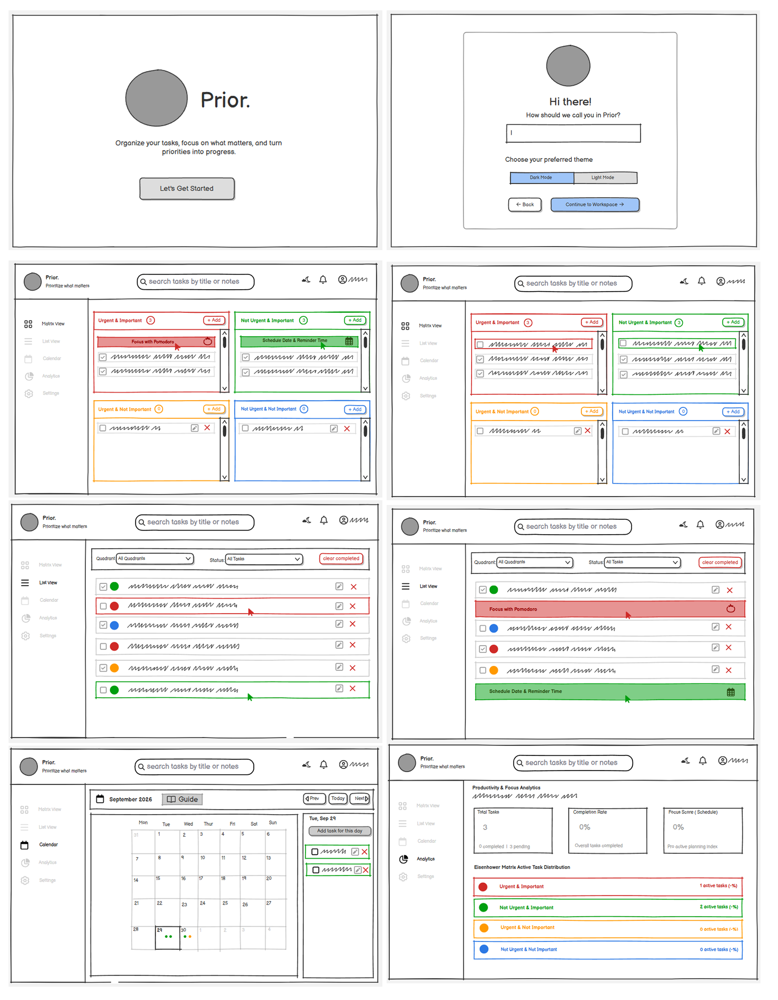

<p align="center">
  
</p>

# Prior - Eisenhower Matrix Desktop Task Manager

#### Video Demo: <YOUTUBE_URL>

#### Description:

**Prior** is an offline-first desktop productivity application built in Python using **CustomTkinter** and **SQLite**. It implements the **Eisenhower Matrix time-management methodology**, empowering users to organize, schedule, and execute tasks based on urgency and importance rather than overwhelming, flat to-do lists.

---

### The Problem & Motivation

Modern professionals and students frequently suffer from "urgency bias" - the psychological tendency to tackle whatever feels urgent at the expense of tasks that are truly important for long-term growth. Standard to-do list applications exacerbate this issue by presenting flat, unprioritized lists where a critical project deadline looks identical to a routine errand.

Prior was built to solve this friction. By forcing a two-dimensional decision on every task - **Is it Urgent?** and **Is it Important?** - Prior categorizes work into four distinct operational quadrants:
1. **Q1: Do First (Urgent & Important)** - Immediate crises, critical bugs, and hard deadlines.
2. **Q2: Schedule (Not Urgent & Important)** - Deep work, long-term learning, strategic planning, and self-care.
3. **Q3: Delegate (Urgent & Not Important)** - Interruptions, quick requests, and administrative overhead.
4. **Q4: Eliminate (Not Urgent & Not Important)** - Time-wasters, trivia, and low-value tasks safe to drop.

---

### UI Prototyping & Wireframe Design

> **Designed & Wireframed with [Balsamiq](https://balsamiq.com/)**

Prior was built with a deliberate design-first approach. Before writing any frontend or database code, extensive effort was invested into architecting and prototyping the entire user experience using **Balsamiq**. This wireframing phase allowed for rapid iteration on visual hierarchy, quadrant layout balance, task creation ergonomics, and seamless Pomodoro workflow integration.



*Comprehensive wireframe collage crafted using Balsamiq, establishing the complete UX/UI architecture and interaction blueprint prior to implementation.*

---

### Key Features

* **Interactive Eisenhower Matrix Workspace**: A dynamic four-quadrant board with visual color cues, custom card frames, and smooth scrolling.
* **Smart Runway Warnings & Deadline Nudges**: Pure algorithms evaluate task estimated durations against drop-dead times to alert users before high-stakes tasks become late.
* **Integrated Pomodoro Focus Timer**: An on-screen and modal timer that tracks deep work sprints and automatically logs productive minutes to the local database.
* **Visual Productivity Analytics**: Dedicated analytics dashboard displaying quadrant completion ratios, weekly time-scope toggles, and daily focus trends.
* **System Tray & Single-Instance IPC**: Minimizes to the Windows system notification area and uses a local socket server to ensure single-instance taskbar activation with zero duplicate windows.
* **Seamless Dark and Light Modes**: Hand-tailored color tokens (Creamy Soft Paper / OLED Black) with synchronized Windows 11 DWM titlebar and Win32 background brushes to eliminate OS window flickering.

---

### File & Module Architecture

```text
Prior/
├── project.py               # Main entrypoint + top-level functions + IPC client (duplicate instance preventer)
├── test_project.py          # Pytest automated test suite (unit tests)
├── database.py              # SQLite schema, migrations, and CRUD operations
├── requirements.txt         # Pip dependency manifest
├── README.md                # project documentation
├── assets/                  # Icons, fonts, and wireframe assets
│   ├── icon.ico             # Application icon
│   ├── icon.png             # High-res PNG logo
│   └── wireframes/          # UI prototyping collages and diagrams
│       └── balsamiq_wireframes.png
└── ui/                      # Modular CustomTkinter GUI package
    ├── app.py               # Main application window, lifecycle & IPC server
    ├── theme.py             # Design tokens, quadrant color palettes & DWM titlebar hooks
    ├── matrix_view.py       # 4-quadrant interactive canvas view
    ├── list_view.py         # Searchable, filterable tabular list view
    ├── calendar_view.py     # Calendar view for scheduled deadline tasks
    ├── analytics_view.py    # Productivity graphs and focus session stats
    ├── task_modal.py        # Task creation and editing wizard
    ├── pomodoro_modal.py    # Focus timer modal with session logging
    ├── schedule_modal.py    # Time-blocking and scheduling dialog
    ├── quadrant_guide_modal.py # Explanatory Eisenhower Matrix guide
    ├── dot_pattern.py       # Custom antialiased dot-matrix card background generator
    ├── smooth_scroll.py     # High-precision canvas scrolling helper
    ├── tray.py              # Background system tray daemon (pystray)
    └── windows_integration.py # Windows AppUserModelID, Start Menu shortcut & taskbar Jump List
```

#### Explanation of Core Files

* **`project.py`**: The application entry point containing `main()` and core standalone business logic functions:
  * `determine_quadrant(is_urgent: bool, is_important: bool) -> str`: Pure classifier determining quadrant assignment.
  * `filter_tasks(tasks, search_query, quadrant_filter, show_completed, include_archived) -> list`: Multi-criteria search and filter engine.
  * `calculate_drop_dead_time(due_date_str, due_time_str) -> datetime`: High-precision timestamp calculator.
  * `is_task_delayed(task, current_dt) -> bool`: Runway deadline threshold detector.
  * `get_task_notifications(tasks, current_dt) -> list`: Notification dispatch generator.
  * `is_existing_instance_running()`: IPC client that brings any already-running Prior window to the foreground via a localhost TCP socket.
* **`test_project.py`**: Comprehensive `pytest` test suite with 50 unit tests validating all top-level functions across boundary cases, leap years, overdue scenarios, and reminder triggers.
* **`database.py`**: SQLite database layer managing schema migrations, task CRUD operations, user profile settings, and Pomodoro focus logs.
* **`ui/theme.py`**: Houses the design tokens and Windows DWM titlebar hooks that synchronize title bar colors and native Win32 window class background brushes (`GCLP_HBRBACKGROUND`) across light and dark modes.

---

### Design Decisions & Technical Trade-offs

1. **CustomTkinter over PyQt / Electron**:
   * *Decision*: Used CustomTkinter for native Python desktop performance.
   * *Rationale*: Avoided the multi-hundred-megabyte memory footprint of Electron/Chromium and the heavy binary dependencies and licensing complexities of PyQt. CustomTkinter gives modern rounded widgets, dark/light appearance modes, and crisp DPI scaling while keeping the app lightweight and fast to boot.

2. **SQLite over Flat Files (JSON / CSV)**:
   * *Decision*: Used SQLite (`sqlite3`) as an embedded, zero-configuration relational database.
   * *Rationale*: Storing tasks and Pomodoro session logs in SQLite ensures ACID compliance, indexed search queries, and historical analytics aggregation that flat files cannot efficiently provide.

3. **Separation of Pure Business Logic in `project.py`**:
   * *Decision*: Kept matrix classification, runway delay formulas, search filters, and notification algorithms as pure Python functions in `project.py`, decoupled from GUI widgets.
   * *Rationale*: Enables 100% automated test coverage in `test_project.py` without requiring GUI rendering during CI/test runs.

4. **Local Socket IPC for Single-Instance Control**:
   * *Decision*: Implemented a lightweight socket listener on `127.0.0.1:49281`.
   * *Rationale*: Prevents multiple instances of Prior from running concurrently when launching from desktop or taskbar shortcuts. When clicked again, the new process communicates with the existing instance to smoothly restore the window and exits cleanly.

---

### Installation & Setup

#### Prerequisites
* **Python 3.10+** installed on your system.
* Windows 10 or 11 (fully supported; macOS/Linux run with cross-platform CustomTkinter fallback).

#### 1. Clone the Repository
```bash
git clone https://github.com/Paraseww/Prior.git
cd Prior
```

#### 2. Install Dependencies
```bash
pip install -r requirements.txt
```

#### 3. Run the Application
```bash
python project.py
```

---

### Running the Test Suite

Prior includes automated unit tests covering all required standalone functions in `project.py`. Run the tests using `pytest`:

```bash
pytest
```

All 50 unit test cases will run and pass:
```text
============================= test session starts =============================
platform win32 -- Python 3.13.2, pytest-9.1.1, pluggy-1.6.0
rootdir: G:\Prior\Prior
collected 50 items

test_project.py ..................................................       [100%]

============================= 50 passed in 14.69s =============================
```
